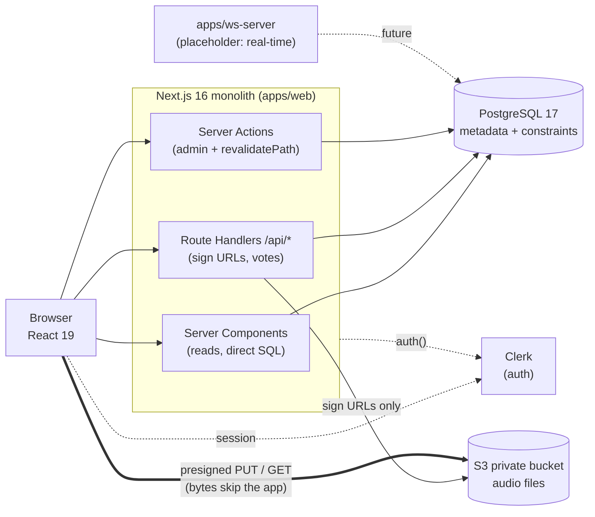
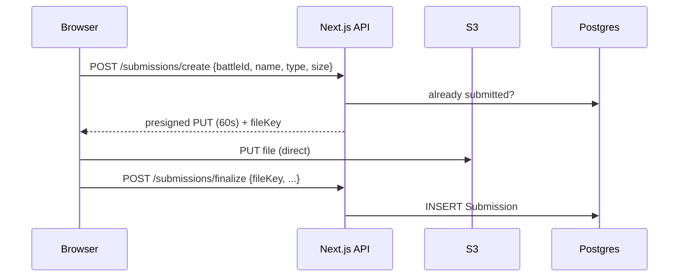

# Beat Battles: System Design Cheat Sheet

> **Prompt:** Producers upload a beat to a weekly battle. The community listens and votes. An admin crowns a winner, and past battles stay browsable.

## Core insight

**Big files, small metadata. Bandwidth is the scaling problem, not compute.**
Estimate: 5k entries/week ≈ 40 GB of storage. 50k voters × 20 listens × 8 MB ≈ **8 TB/week of egress**. Votes peak at about 50 writes/sec, which Postgres handles easily.

## Architecture



## Upload flow



## Decisions and reasoning

| Decision | Why | Trade-off |
|---|---|---|
| Monolith (Next.js) | One deployable holding SSR, API and admin. Small team, small traffic. | Parts can't scale independently |
| Postgres, raw `pg` (Prisma dropped) | Relational data, and the rules are integrity constraints. Full SQL control. | No generated types or migration tooling |
| Clerk, no User table | Identity is a solved problem. No sync job. | Vendor lock-in. `username` is denormalized and can go stale |
| S3 + presigned URLs | Files skip the app server, so no body-size or timeout limits. Bucket stays private. | Integrity checks move to the finalize step |
| DB constraints for the rules | `UNIQUE(userId, battleId)` on Submission and Vote. Vote is an `ON CONFLICT DO UPDATE` upsert, which can't be raced. | — |
| Admin winner in a transaction | Clears placements and sets the winner atomically | Manual step, a human bottleneck |
| UTC pinned in the driver | Deadlines agree between server and client | — |
| Monorepo + `ws-server` stub | Room for a real-time service with a different load profile | Not built yet |

## Data model

```
Battle(id, title, slug UNIQUE, status open|closed, startsAt, endsAt, hiddenFromHistory)
Submission(id, userId, username, battleId→Battle, fileKey UNIQUE, fileUrl, size, mime, placement)
           UNIQUE(userId, battleId)
Vote(id, userId, battleId→Battle, submissionId→Submission)   UNIQUE(userId, battleId)
-- every FK uses ON DELETE CASCADE
```

## Known gaps (raise them yourself)

1. **Finalize trusts the client.** It doesn't check that the object exists or that the key is under the caller's prefix. **Fix:** `HeadObject` and build the key on the server.
2. **Finalize skips the battle-open check.** The vote route has it.
3. **S3 doesn't enforce the declared size or type.** **Fix:** presigned POST with `content-length-range`.
4. **Playback signs any key for any logged-in user.** **Fix:** confirm the key is in `Submission`.
5. **Duplicate submit is check-then-insert.** A race returns a 500 instead of a 409.
6. **`endsAt` isn't enforced.** Closing a battle is manual. **Fix:** server-side check plus a cron job to auto-close.
7. **Vote counts load every vote row.** **Fix:** `GROUP BY` plus indexes on `battleId`.
8. **Middleware protects routes that don't exist.** The APIs are safe only because each handler calls `auth()` itself.

## Scaling path

**CDN** (CloudFront signed cookies, for egress) → **async processing** (S3 event → SQS → worker: validate, preview clip, hash for duplicates) → **real-time leaderboard** (`ws-server` + `LISTEN/NOTIFY` or Redis pub/sub; consider hiding counts until close) → **read scaling** (ISR, read replicas, PgBouncer) → **abuse controls** (rate limits, CAPTCHA, account age).

## 45-minute plan

Clarify 5 · Estimates 3 · API + data model 7 · High-level design 10 · Deep dives (upload, vote integrity, playback auth) 12 · Scale and failure modes 8

> **Closing line:** "It's a monolith because it's small. The two hard parts sit at the right layer: large files bypass the app through presigned URLs, and voting rules are database constraints, not application checks."
